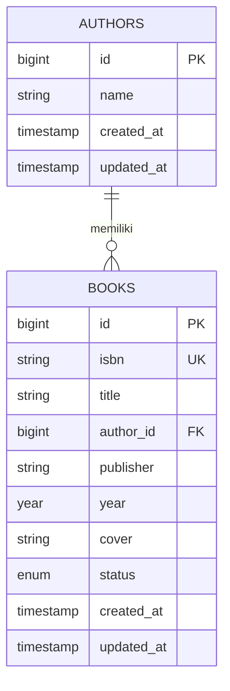

# Praktikum 6 - 8 — Library Management System

Aplikasi **Library Management System** berbasis Laravel dan Filament untuk mengelola data buku dan penulis melalui admin panel. Proyek ini dibuat sebagai bagian dari praktikum Pemrograman Berbasis Web (PBW).

## Identitas

| Keterangan | Detail |
|---|---|
| Nama | Reza Putra Arialesta |
| NPM | 4524210086 |
| Kelas | PBW-A |
| Praktikum | Praktikum 6 - 8 |
| Mata Kuliah | Pemrograman Berbasis Web |

## Deskripsi Proyek

Aplikasi ini menyediakan panel administrasi untuk mengelola koleksi buku dan data penulis. Admin panel dibuat menggunakan **Filament**, sedangkan pengelolaan data dan relasi menggunakan **Laravel Eloquent ORM**.

Fitur yang sudah terlihat pada source code proyek:

- Login ke admin panel Filament melalui `/admin`.
- CRUD data buku (*Books*).
- CRUD data penulis (*Authors*).
- Relasi satu-ke-banyak antara penulis dan buku.
- Pencarian dan pengurutan data buku.
- Filter buku berdasarkan status, tahun, dan penulis.
- Upload gambar sampul buku.
- Data awal buku dan penulis melalui database seeder.

> **Catatan kelengkapan tugas:** README ini disusun berdasarkan source code proyek yang diberikan. Pada source code tersebut, fitur dasar di atas sudah tersedia. Fitur tambahan pada Tugas 2—description, role-based access yang benar-benar membatasi aksi, dashboard widget statistik, dan kategori buku—belum ditemukan implementasinya. Bagian tersebut ditandai sebagai pekerjaan lanjutan agar laporan tidak mengklaim fitur yang belum ada. Perbarui status dan dokumentasi setelah implementasinya selesai.

## Teknologi yang Digunakan

- **PHP** ^8.2
- **Laravel** ^12
- **Filament** ^3
- **SQLite** (konfigurasi default pada `.env.example`)
- **Composer**
- **Node.js dan NPM** untuk aset frontend

## Fitur Aplikasi

### 1. Book Management

Data buku memiliki atribut:

| Field | Keterangan |
|---|---|
| ISBN | Nomor identitas buku, harus unik |
| Title | Judul buku |
| Author | Penulis buku |
| Publisher | Penerbit buku |
| Year | Tahun terbit |
| Cover | Gambar sampul buku |
| Status | Ketersediaan buku (`available` atau `borrowed`) |

Pengguna admin panel dapat menambahkan, melihat, mengubah, dan menghapus data buku. Tabel buku juga menyediakan pencarian, pengurutan, dan filter.

### 2. Author Management

Data penulis menyimpan nama penulis. Satu penulis dapat memiliki banyak buku, sedangkan setiap buku terhubung ke satu penulis.

### 3. Search, Sort, dan Filter

Pada daftar buku tersedia:

- Pencarian berdasarkan ISBN, judul, dan nama penulis.
- Pengurutan kolom yang mendukung sorting.
- Filter berdasarkan status buku.
- Filter berdasarkan tahun terbit.
- Filter berdasarkan penulis.

### 4. Cover Upload

Form buku menyediakan fitur unggah gambar sampul dengan format JPEG, PNG, atau WebP dan batas ukuran 2 MB.

## Instalasi dan Menjalankan Aplikasi

### Prasyarat

Pastikan perangkat telah memiliki:

- PHP 8.2 atau lebih baru.
- Composer.
- Node.js dan NPM.
- Ekstensi PHP yang dibutuhkan Laravel, termasuk `pdo_sqlite` jika menggunakan SQLite.

### Langkah instalasi

1. Clone repository:

   ```bash
   git clone https://github.com/USERNAME/REPOSITORY.git
   cd REPOSITORY
   ```

   Ganti `USERNAME/REPOSITORY` dengan alamat repository GitHub yang digunakan.

2. Install dependency PHP:

   ```bash
   composer install
   ```

3. Buat file environment:

   ```bash
   cp .env.example .env
   ```

   Pada Windows Command Prompt, dapat gunakan:

   ```bat
   copy .env.example .env
   ```

4. Buat application key:

   ```bash
   php artisan key:generate
   ```

5. Siapkan database SQLite. Jika file database belum tersedia, buat file `database/database.sqlite`.

   Windows PowerShell:

   ```powershell
   New-Item database/database.sqlite -ItemType File
   ```

   Jika file sudah ada, langkah ini tidak perlu diulangi.

6. Jalankan migration dan seeder:

   ```bash
   php artisan migrate --seed
   ```

7. Buat symbolic link untuk file upload:

   ```bash
   php artisan storage:link
   ```

8. Install dan build aset frontend:

   ```bash
   npm install
   npm run build
   ```

9. Jalankan server:

   ```bash
   php artisan serve
   ```

10. Buka aplikasi pada `http://127.0.0.1:8000` dan akses admin panel melalui `http://127.0.0.1:8000/admin`.


## Akun Login

Seeder pada source code membuat akun berikut:

| Role/Label | Email |
|---|---|
| Admin User (akun awal) | `admin@example.com` |

Password akun awal mengikuti password default dari `UserFactory`, yaitu `password`, kecuali sudah diubah secara manual.

**Peringatan:** akun dan password tersebut hanya untuk lingkungan praktikum/lokal. Jangan gunakan kredensial default pada aplikasi produksi.

## Struktur Database dan Relasi

### ERD

Diagram berikut menggambarkan struktur database yang sudah ada pada source code saat ini.



### Penjelasan relasi

- `authors` ke `books` adalah relasi **one-to-many**.
- Satu penulis dapat mempunyai beberapa buku.
- Satu buku hanya mempunyai satu penulis melalui `author_id`.
- Kolom `books.author_id` merupakan foreign key yang mengacu pada `authors.id`.
- Pada migration, foreign key menggunakan `onDelete('cascade')`. Artinya, penghapusan data penulis akan ikut menghapus buku yang terkait. Perilaku ini perlu dipertimbangkan ketika aplikasi digunakan dengan data nyata.

### Alur request hingga response

1. Pengguna membuka halaman `/admin`.
2. Laravel menerima HTTP request dan menjalankan middleware autentikasi Filament.
3. Jika pengguna belum login, aplikasi menampilkan halaman login.
4. Setelah autentikasi berhasil, Filament menampilkan panel admin.
5. Ketika pengguna membuka menu Books atau Authors, Filament Resource menangani tampilan tabel dan form.
6. Resource berinteraksi dengan model Eloquent untuk membaca atau mengubah data pada database.
7. Laravel mengembalikan response berupa halaman admin yang diperbarui.

## Dokumentasi Screenshot

Simpan screenshot ke folder `docs/screenshots/` di repository. Gunakan nama file seperti contoh berikut agar dokumentasi mudah dibaca.

| Bukti | File screenshot |
|---|---|
| Login berhasil dan admin panel tampil | `01-admin-panel.png` |
| Daftar buku dengan data seeder | `02-book-list.png` |
| Form create book | `03-create-book.png` |
| Hasil pencarian buku | `04-book-search.png` |
| Filter buku yang sedang aktif | `05-active-filter.png` |

### 1. Admin Panel


### 2. Daftar Buku dengan Data Seeder


### 3. Form Create Book


### 4. Hasil Pencarian


### 5. Filter Aktif


## Tugas 2 — Kustomisasi dan Pengembangan

Bagian ini merupakan daftar implementasi yang perlu dipenuhi dan didokumentasikan sesuai instruksi praktikum.

### 1. Field Description pada Book

Target implementasi:

- Migration untuk menambahkan kolom `description` bertipe `text` pada tabel `books`.
- Menambahkan `description` ke properti `$fillable` pada model `Book`.
- Menambahkan komponen `Textarea` pada form `BookResource`.
- Menambahkan data deskripsi otomatis melalui `fake()->paragraph()` pada `BookFactory`.

**Status pada source code yang diperiksa: belum ditemukan.**

### 2. Role-Based Access Control

Target hak akses:

| Role | View | Create | Edit | Delete |
|---|---:|---:|---:|---:|
| Admin | Ya | Ya | Ya | Ya |
| Staff | Ya | Ya | Ya | Tidak |
| Viewer | Ya | Tidak | Tidak | Tidak |

Target implementasi:

- Menambahkan kolom `role` pada tabel `users`.
- Menambahkan seeder akun admin, staff, dan viewer.
- Mengatur otorisasi melalui `BookPolicy`.
- Memastikan aksi pada Filament mengikuti policy, bukan hanya menyembunyikan tombol pada tampilan.

**Status pada source code yang diperiksa: belum sesuai.** `BookPolicy` saat ini mengembalikan `true` untuk seluruh aksi, sehingga belum membatasi akses berdasarkan role.

### 3. Dashboard Widget

Target widget dashboard:

- Total buku.
- Total penulis.
- Jumlah buku berstatus `available`.
- Jumlah buku berstatus `borrowed`.
- Visualisasi statistik atau chart.

**Status pada source code yang diperiksa: widget statistik khusus belum ditemukan.**

### 4. Kategori Buku

Target implementasi:

- Membuat model dan migration `Category`.
- Membuat tabel pivot untuk relasi many-to-many antara `books` dan `categories`.
- Menambahkan relasi `belongsToMany()` pada model `Book` dan `Category`.
- Menambahkan pilihan kategori multiple select pada form buku.

**Status pada source code yang diperiksa: belum ditemukan.**

## Tugas 3 — Analisis dan Dokumentasi

### 1. Perbandingan Filament dan CRUD Manual

| Aspek | Filament | CRUD Manual |
|---|---|---|
| Pembuatan halaman | Resource menyediakan pola CRUD siap pakai | Perlu membuat route, controller, dan view |
| Form dan tabel | Komponen sudah tersedia | Komponen dibuat dan diatur sendiri |
| Pencarian dan filter | Dapat dikonfigurasi melalui table | Perlu dibuat secara manual |
| Fleksibilitas UI | Mengikuti pola dan komponen Filament | Lebih bebas mengatur tampilan |
| Waktu pengembangan | Relatif cepat untuk panel admin | Cenderung lebih lama |
| Pemeliharaan | Struktur Resource cukup terpusat | Bergantung pada struktur kode yang dibuat |

**Kelebihan Filament:**

- Mempercepat pembuatan panel administrasi.
- Menyediakan komponen form, tabel, filter, dan action.
- Terintegrasi dengan Laravel dan Eloquent.
- Cocok untuk aplikasi internal yang membutuhkan pengelolaan data.

**Kekurangan Filament:**

- Tampilan admin mengikuti pola komponen Filament.
- Kustomisasi yang sangat spesifik dapat membutuhkan pemahaman API Filament.
- Menambahkan dependency pada proyek.

**Kelebihan CRUD manual:**

- Kontrol penuh atas tampilan dan alur aplikasi.
- Dapat disesuaikan dengan kebutuhan UI/UX yang sangat spesifik.
- Tidak bergantung pada pola Resource Filament.

**Kekurangan CRUD manual:**

- Membutuhkan lebih banyak kode.
- Validasi, pencarian, filter, pagination, dan otorisasi harus dirancang serta diuji sendiri.
- Waktu pengembangan dan pemeliharaan dapat lebih besar.

**Kapan menggunakan Filament?**

Filament tepat digunakan ketika aplikasi membutuhkan dashboard atau panel admin berbasis Laravel dengan fitur CRUD yang umum, seperti sistem inventaris, perpustakaan, dan pengelolaan data internal.

**Kapan tidak menggunakan Filament?**

CRUD manual lebih tepat dipertimbangkan ketika aplikasi membutuhkan pengalaman pengguna yang sangat berbeda dari panel admin standar, memiliki alur interaksi khusus, atau ketika tampilan dan perilaku antarmuka harus dikontrol sepenuhnya.

### 2. Refleksi Pembelajaran


**Hal yang dipelajari**

Praktikum ini membantu memahami penggunaan Laravel dan Filament untuk membangun aplikasi pengelolaan data. Saya mempelajari pembuatan Resource, penggunaan form dan table, relasi model Eloquent, migration, factory, serta seeder. Saya juga memahami bahwa Filament dapat mempercepat pembuatan panel administrasi karena menyediakan komponen CRUD yang dapat dikonfigurasi.

**Kesulitan dan cara mengatasinya**

Salah satu tantangan dalam praktikum adalah memahami hubungan antara konfigurasi Resource Filament, model, migration, dan database. Ketika terjadi error, saya memeriksa pesan error, menelusuri file yang berkaitan, membaca dokumentasi, dan menguji perubahan secara bertahap sampai menemukan penyebabnya.

**Rencana pengembangan selanjutnya**

Pengembangan berikutnya adalah melengkapi field description, menerapkan role-based access control, menambahkan widget statistik dashboard, dan membuat fitur kategori buku. Setelah itu, aplikasi dapat dikembangkan dengan fitur peminjaman, pengembalian, serta riwayat transaksi buku.

## Pengembang

**Reza Putra Arialesta**  
Mahasiswa Teknologi Informasi — Universitas Pancasila

---

*Dokumentasi ini dibuat untuk keperluan laporan Praktikum 6 - 8 Pemrograman Berbasis Web.*
